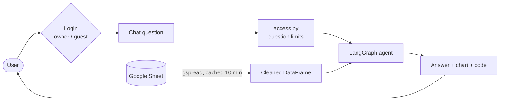
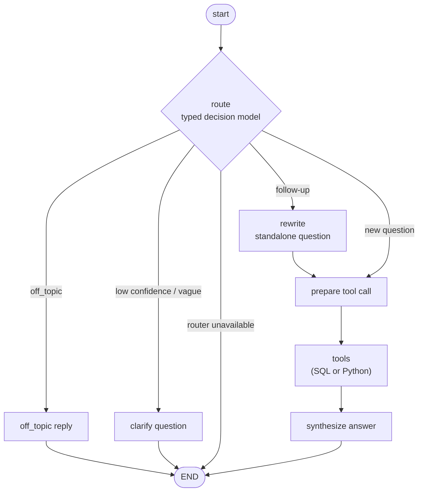
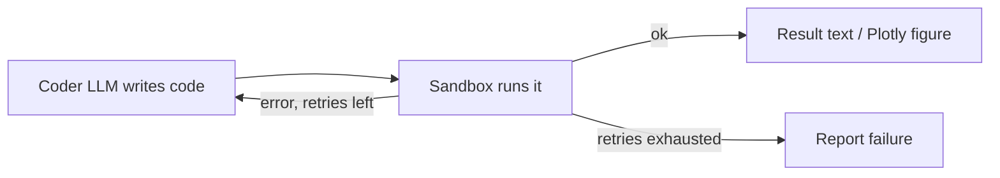

# kevin-workout-analytics-app (aka GainsGPT)
[website link](https://kevins-gains-gpt.streamlit.app/)
**Warning: reponses might be slow due to free tier models reasoning/inference times**


Hello, this repo is a Streamlit app that lets you generate insights from my workout logs in natural language! Ask a question like "How much did Kevin Bench last week?" and a LangGraph flow will route your question to an approrpiate tool, write code against the data, run it in a sandbox, and synthesize the results to answer your question.

The base data is a Google Sheet with basic (exercise, weight, reps, RPE, etc.) and LLM-enriched (workout_rating, injury_ind, etc.) information about all my workouts since I started this project.

## Requirements

- **Free (mostly...)**: Streamlit Community Cloud for app deployment, Gemini and OpenRouter API's for inference, and guest usage is capped (sorry lol).
- **Nothing running locally**: Deployment and inference need to always be available.
- **Faithful to data**: numbers come from executed code on dataset, not from the model's memory.
- ** Purpose-built **: Use Jev-like router models to ensure questions are only pertaining to my workout logs and nothing else.
- **Basic safety for LLM generated code execution**: SQL is read-only, and Python runs in an isolated process with no imports, files, or network access.
- **Keep personal data personal**: free-text `Comment` values are masked from models.
- **Quality of life chat features**: short term memory for follow-up questions.
- **Streamlined swapping of models**: change which model does which job by editing one TOML file, with no code changes.
- **Easily expandable**: Tools can easily be added later on to increase the functionality of the app.

## Architecture

### Request flow



### Agent graph



### Code generation loop (inside each tool)



**How it works**

1. **Route**: one structured call classifies the question as `sql`, `python` (needed for charts), `clarify`, or `off_topic`, and flags follow-ups and chart requests.
2. **Rewrite** (follow-ups only): turns "and for squats?" into a standalone question using chat history.
3. **Code**: the coder model writes DuckDB SQL or pandas/Plotly Python using a schema description of the data.
4. **Sandbox**: SQL allows a single `SELECT`, with file and network access off, a timeout, and a row cap. Python gets a static AST check, then runs in a separate process with restricted builtins, a scrubbed environment, and a hard timeout.
5. **Synthesize**: the answer model turns the execution result into the final reply.

Each step uses an ordered model chain from [models.toml](models.toml). If a model hits a rate limit or outage, or its API key is missing, the next one is tried. Conversation memory is kept per thread by a LangGraph checkpointer.

## Example Chat

**Initial Question**


**Follow-up Question**


## Repo Layout

```
workout-llm/
├── app.py                  # Streamlit entry point: login, chat UI, caching
├── models.toml             # model registry, per-node fallback chains, settings
├── requirements.txt        # pinned dependencies (Python 3.12)
├── pytest.ini
├── .streamlit/config.toml  # Streamlit settings (secrets.toml is git-ignored)
├── .devcontainer/          # Codespaces / dev container (Python 3.12, port 8501)
├── src/workout_chat/
│   ├── graph.py            # LangGraph workflow and run_turn()
│   ├── state.py            # graph state
│   ├── nodes/              # router, rewrite, synthesize, clarify / off-topic replies
│   ├── tools/              # tool registry plus SQL and Python tools, code-retry loop
│   ├── sandbox.py          # safe SQL (DuckDB) and Python execution
│   ├── python_worker.py    # subprocess worker for sandboxed Python
│   ├── decisions.py        # typed-decision router (Choice / Noul / Score) with fallbacks
│   ├── llm.py              # chat-model factory, fallback chain, error classification
│   ├── prompts.py          # all prompt text
│   ├── schema.py           # data dictionary, LLM schema context, opening greeting
│   ├── data.py             # Google Sheets loading and cleaning
│   ├── access.py           # roles, passwords, guest limits
│   └── config.py           # secrets, constants, models.toml loader
├── tests/                  # unit tests (fake LLMs) + live eval harness and question set
└── scripts/                # ask from the terminal, check the sheet, smoke-test models, try the sandbox
```

## Tech Stack

| Layer | Tools |
|---|---|
| UI / hosting | Streamlit, Streamlit Community Cloud |
| Agent orchestration | LangGraph, LangChain |
| LLM providers | Google Gemini (`langchain-google-genai`), OpenRouter (`langchain-openai`, Decisions API) |
| Data store | Google Sheets via `gspread` and a read-only service account |
| Analysis | pandas, NumPy, DuckDB (SQL) |
| Charts | Plotly |
| Validation / config | Pydantic, TOML |
| Testing | pytest, PyYAML (live eval questions with ground truth computed from the data) |
